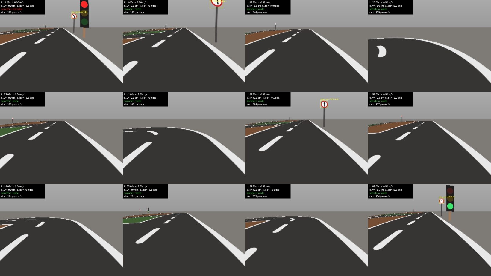

# C.A.FATEC.R.B — Vista

Carro autônomo em escala 1:10 para a **[RoboCar Race 2026](https://www.robocarrace.com.br/)**,
categoria **MASTER**. FATEC Santo André · Engenharia Mecatrônica.

**Vista** é a IA do carro: lê a câmera, entende a pista (faixa, semáforo,
placas), decide e manda `(v, ω)` para o ESP32.

| | |
|---|---|
| 🏁 Treinos na pista oficial | **04/12/2026** — único dia na pista real |
| 🏁 Prova | **05/12/2026** |
| 🚗 Carro | tração diferencial, 400 × 241 mm (REV03) |
| 📷 Câmera | IMX219 fisheye 120°, 1640×1232 @ 30 |
| 🧠 Computação | Jetson Orin Nano + ESP32-S3 |

## Estratégia

1. **Agora — simulador.** A pista é padronizada pelo regulamento, então dá para
   treinar antes do carro existir. O **Vista-Sim** é feito só para este carro e
   esta prova.
2. **Quando o carro estiver pronto — dados reais** da pista caseira até a
   competição.

## Vista-Sim



Câmera fisheye virtual do carro, dirigida pelo piloto-oráculo, numa volta
completa: largada no vermelho, saída só no verde, placas rotuladas
automaticamente.

```bash
pip install -e ".[dev]"
python -m vista_sim.maps.build_master        # (re)gera o mapa oficial
python -m tools.sim_demo --out runs/demo     # uma volta + vídeo
python -m tools.sim_demo --bench             # passos/s
pytest
```

```python
from vista_sim.env import VistaSimEnv

env = VistaSimEnv(seed=0)
obs, info = env.reset()
obs, telemetria, verdade, fim, info = env.step(v=0.5, omega=0.0)
```

O Vista recebe `obs` (imagem) e `telemetria` (odometria **dos encoders**, como
no ESP32 real). `verdade` — pose, `e_y`, `e_ψ`, placas visíveis com caixa,
estado do semáforo — serve para medir o Vista e rotular dados, **nunca** como
entrada dele.

### Fonte única de verdade

O simulador lê os mesmos arquivos do carro real. Calibrou a câmera → o
simulador muda junto.

| Arquivo | Conteúdo | Origem |
|---|---|---|
| `config/car.yaml` | geometria, motor, encoder, sensores | desenho REV03 |
| `config/camera/intrinsics.yaml` | modelo fisheye | ⚠️ estimado — calibrar |
| `config/camera/extrinsics.yaml` | pose da câmera, pitch | REV03 — medir |
| `maps/robocar_master.yaml` | mapa oficial | gerado do regulamento |

### Estado (fases do CLAUDE.md §5A)

| Fase | Entrega | Estado |
|---|---|---|
| **S1** | car.yaml, mapa vetorial, cinemática, renderizador `fast` | ✅ volta completa; **1.092 passos/s** em 320×240 |
| S2 | Vista em loop fechado + cenários de regressão | ⬜ depende do Vista |
| S3 | renderizador `photo` (Blender) + rótulos automáticos | ⬜ |
| S4 | fidelidade sim × real + ultrassom/IMU | ⬜ depende do carro |

## Documentação

| Documento | Sobre |
|---|---|
| [Regulamento](docs/regulamento.md) | O que as regras exigem — **inclui o lido nas figuras** |
| [Análise de FOV](docs/fov-analise.md) | Por que o semáforo não restringe o pitch |
| [Diário de construção](docs/diario-de-construcao.md) | Todo o caminho, com problemas e números |
| [ADR 001](docs/adr/001-mapa-pelo-regulamento.md) | Mapa pelo regulamento, não pelo `.obj` do organizador |
| [ADR 002](docs/adr/002-camera-fisheye-e-chao-por-grade.md) | Câmera fisheye em NumPy e chão por grade |

## O que o regulamento diz e o simulador do organizador não

Lendo as **figuras** do regulamento (a extração de texto do PDF não pega as
cotas):

- **6 classes de placa**, não 3 — as 3 de proibição mudam a lógica de decisão.
- Placa **Ø150 com a base a 400 mm** (o simulador do organizador tem Ø300).
- Semáforo com centros a **530 / 390 / 250 mm** — o que derruba o alerta de
  pitch: com 15° as três lentes cabem.
- Vias norte-sul de **100 cm**, leste-oeste de **80 cm**; linha central
  **branca**.

Detalhes e perguntas para a organização em [docs/regulamento.md](docs/regulamento.md).
