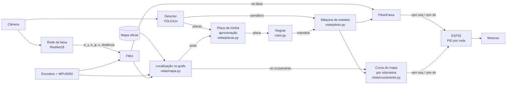

# Visão geral do projeto — C.A.FATEC.R.B · Vista

**Atualizado em 09/11/2026.** Faltam **25 dias** para os treinos na pista oficial (04/12) e **26** para a prova (05/12).

Este é o documento para quem chega agora: o que é o projeto, o que já existe, o que os números dizem, o problema em aberto e o plano até a prova. O histórico detalhado, com cada problema e como foi resolvido, está no [diário de construção](diario-de-construcao.md).

---

## 1. Objetivo

Um carro autônomo em escala 1:10 para a **RoboCar Race 2026**, categoria **MASTER**. Ele larga no semáforo, percorre a minicidade pela rota que as **placas** definem no dia (regulamento 3.5.2), sem sair da pista nem desrespeitar placa. As regras, incluindo o que só aparece nas figuras do PDF, estão em [regulamento.md](regulamento.md).

**Vista** é a IA do carro: lê a câmera, entende a pista (faixa, cruzamento, placas, semáforo), decide e manda a **rotação de cada roda** para o ESP32.

## 2. Estratégia

1. **Simulador primeiro.** A pista é padronizada pelo regulamento, então dá para treinar o Vista antes do carro existir. O **Vista-Sim** é feito só para este carro e esta prova.
2. **Dados reais depois.** Quando o carro estiver pronto, gravar na pista caseira e ajustar as redes à câmera e à luz de verdade.

---

## 3. O carro

| Item | Valor | Origem |
|---|---|---|
| Chassi | 400 × 241 mm, desenho **REV03** | desenho |
| Tração | **diferencial**: 2 rodas Ø65 mm + rodízio; bitola 214 mm. **Não tem direção**: curva pela diferença de rotação | desenho |
| Motores | 530 rpm a 12 V → ~486 rpm a 11 V (~1,65 m/s na roda) | kit |
| Encoder | 440 pulsos/volta | ⚠️ estimado — medir |
| Controle das rodas | **ESP32-S3**: recebe **rpm de cada roda**, PID por roda a 100 Hz | decidido pela equipe |
| Cérebro | **Jetson Orin Nano** | — |
| Câmera | **IMX219 120° 8 MP**, fisheye; captura 1640×1232, processamento 410×308; pitch 15° | REV03; ⚠️ intrínsecos estimados |
| IMU | **MPU6050** (6 eixos, sem magnetômetro) | decidido pela equipe |
| Distância | 4× HC-SR04 | desenho |
| Bateria | LiPo 4S 2200 mAh | — |

Tudo isso está em [`config/car.yaml`](../config/car.yaml) e [`config/camera/`](../config/camera/), a **fonte única de verdade**: o simulador e o Vista real leem os mesmos arquivos.

---

## 4. Arquitetura do Vista (o que vai rodar no carro)



**Na faixa** a rede dirige (com o filtro). **No cruzamento** — onde não há
linha pintada para ver — o Vista segue a curva do **mapa oficial** com a pose
da odometria, e a rede volta na faixa de saída. A **placa** detectada é
atribuída, pelo mapa, à aproximação a que pertence; `rules.decide` escolhe a
manobra. A **largada** vem do semáforo detectado. Nada de verdade de campo
([ADR 008](adr/008-vista-completo-mapa-odometria-detector.md)).

| Peça | O que faz | Arquivo | Estado |
|---|---|---|---|
| Rede de faixa | imagem + manobra → erro lateral `e_y`, erro de rumo `e_ψ`, curvatura à frente, distância ao cruzamento, "já está dentro?" | `treino/faixa.py` | ✅ treinada no Colab; agora só dirige **na faixa** |
| Detector | 6 placas + semáforo vermelho/amarelo/verde | `treino/deteccao.py` + YOLO11n; no laço: `vista/placas.py` | ✅ treinado; ✅ no laço (falta medir com o YOLO real) |
| Placa da aproximação | cada placa detectada vai para a aproximação do mapa que a explica (pixel e tamanho previstos); votos acumulados | `vista/placas.py` | ✅ 118/119 decisões com detector perfeito |
| Regras | placa → manobra (obrigação, proibição, sem placa = em frente) | `vista_sim/rules.py` | ✅ testado |
| Localização | rua atual pelo grafo do mapa + pose prevista pela odometria e amarrada à faixa pela rede | `vista/mapa.py` | ✅ |
| Cruzamento | curva do mapa seguida por odometria; escala do giroscópio calibrada a cada curva | `vista/cruzamento.py`, `vista/mapa.py` | ✅ |
| Máquina de estados | aguarda verde → faixa ↔ cruzamento | `vista/piloto.py` | ✅ teto 11/12 rotas |
| Filtro | encoders + giroscópio **preveem** o erro; a rede **corrige** | `vista_sim/controle.py` | ✅ testado |
| Controle | percepção → rpm de cada roda; o **centro do carro** segue a faixa | `vista_sim/controle.py` | ✅ 40/40 rotas com a verdade |
| Odometria | deslocamento pelos encoders, rumo pelo giroscópio, viés calibrado parado no vermelho | `vista_sim/imu.py` | ✅ testado |
| Firmware ESP32 | rpm por roda, PID, telemetria | — | ⬜ a fazer |
| Integração na Jetson | câmera → Vista → serial; motores TensorRT | — | ⬜ a fazer |

**O que não vai para o carro:** o **oráculo** — o piloto automático do simulador, que sabe a posição exata e dirige perfeito. Ele existe só para gerar dados de treino e medir o teto.

---

## 5. Vista-Sim (roda no PC ou no Colab)

| Parte | O que simula |
|---|---|
| **Mapa** | a minicidade **lida nas figuras do regulamento**: 13 × 9 m, vias de 100 e 80 cm, ilha Ø1,4 m, 12 cruzamentos ([ADR 001](adr/001-mapa-pelo-regulamento.md)) |
| **Câmera** | fisheye de 120° com o modelo Kannala-Brandt em NumPy; chão por grade pré-calculada ([ADR 002](adr/002-camera-fisheye-e-chao-por-grade.md)) |
| **Carro** | **roda por roda**: PID do ESP32, zona morta, encoder quantizado, raios diferentes, patinação ([ADR 003](adr/003-carro-em-rotacao-de-roda.md)) |
| **Cenários** | por semente: rota pela cidade, placas que levam à rota (6 classes + distratoras), faixas de pedestre, maquetes, público ([ADR 004](adr/004-cenarios-placas-e-iluminacao.md)) |
| **Luz** | 2–8 lâmpadas, sombras do ambiente e do próprio carro, exposição travada |
| **IMU** | MPU6050 com viés de fábrica de até ±20 °/s, escala ±3 %, ruído e deriva ([ADR 005](adr/005-imu-mpu6050-e-odometria.md)) |
| **Fiscal** | `placa_respeitada`, `desrespeitou_placa`, `saiu_da_pista`, `entrou_na_contramao`, `rota_completa` |


---

## 6. Treino

Pipeline completo no [notebook do Colab](../notebooks/treino_vista.ipynb) ([ADR 006](adr/006-treino-com-dados-do-simulador.md), [ADR 007](adr/007-dagger-e-filtro.md)). A **continuação** é o [`treino_vista_v2.ipynb`](../notebooks/treino_vista_v2.ipynb) ([ADR 008](adr/008-vista-completo-mapa-odometria-detector.md)): parte dos modelos de 02/11, mede o Vista completo, ajusta a rede com dados em várias velocidades, faz DAgger com o Vista dirigindo e sobe a velocidade.

1. **Gerar dados** (`tools/gerar_dataset.py`): o oráculo dirige rotas sorteadas e o simulador grava cada imagem com a resposta exata.
   - montagem da câmera sorteada em cada episódio;
   - ruído de recuperação;
   - vistas deslocadas (o carro até ±15 cm e ±15° fora do lugar);
   - semáforo desenhado em estado sorteado;
   - velocidade do oráculo sorteada (0,35–0,80 m/s; v2).
2. **Treinar** a rede de faixa (ResNet18 pré-treinada) e o detector (YOLO11n pré-treinado).
3. **Exportar ONNX** (opset 17, lido por TensorRT ≥ 8.6). O motor TensorRT é gerado **na Jetson**.
4. **Avaliar dirigindo no simulador**, em sementes nunca vistas: o número que importa.
5. **DAgger**: o Vista dirige, o oráculo socorre quando ele se afasta, e essas situações viram treino.

---

## 7. Onde estamos — resultados

### Simulador e controle

| Medida | Resultado |
|---|---|
| Oráculo em rotas sorteadas | **200/200** completas, 0 placa desrespeitada, erro lateral < 3 cm |
| Rotas sorteadas | 25–66 m, 6–15 cruzamentos, **99 %** entram no centro |
| Carro nas 96 conversões da cidade | com o **centro do carro** seguindo a faixa: **0** saídas |
| Odometria no fim da rota (mediana) | só encoders 1,84 m · + giroscópio **0,51 m** · + escala calibrada **0,19 m** |
| Controle com a verdade | **40/40** rotas completas |
| Oráculo a 0,8 m/s | 0/40 com ganho fixo (oscila) → **40/40** com ganho × velocidade ≤ 2,4 |
| Velocidade do simulador (320×240) | ~840 passos/s só o chão · ~240 com a cidade inteira |

### Primeiro treino no Colab (A100, 150 episódios)

| Rede | Resultado na validação (episódios nunca vistos) |
|---|---|
| **Detector** | mAP50 **0,948**, mAP50-95 **0,827**. Semáforo nos 3 estados: **0,99**. Placas que mais escapam: `proibido_virar_direita` (recall 0,72) e `seguir_em_frente` (0,75) |
| **Rede de faixa** | erro de `e_y`: ~**0,3 cm** na faixa, ~**1,0 cm** no cruzamento; `e_ψ` ~0,65°; distância ao cruzamento ~3,6 cm |

### A rede dirigindo sozinha (10 rotas nunca vistas)

| | rotas completas |
|---|---|
| teto (mesmo controle com a verdade) | **10/10** |
| rede de faixa | **4/10** — 5 das 6 falhas **dentro do cruzamento** |

Nessa avaliação a manobra e o semáforo ainda vêm da verdade; o detector ainda não está no laço.

### Na Jetson (medido pela equipe)

- **YOLO11n: 10–25 ms por imagem** na mesma Orin Nano do carro, num projeto anterior (soja): imagem 640×640, pipeline inteiro (pré-processamento + inferência + caixas), FP16 ou FP32. É o pior caso para o Vista, que usa 416×416.
- Os modelos do Vista: rede de faixa **11,3 M** parâmetros (5,6 GFLOPs a 240×320); detector **2,6 M** (2,7 GFLOPs a 416×416).
- **Orçamento:** 33 ms por quadro a 30 fps. Caso típico, ~20 ms as duas redes juntas (cabe); pior caso, ~45 ms (não cabe). Padrão seguro: rede de faixa a cada quadro, detector a cada 2–3 quadros. Medir as duas em TensorRT FP16 de 14–20/11.

### O cruzamento: o problema e a solução (09/11)

Dentro do cruzamento não há linha pintada: a trilha certa é uma **curva
invisível**. Quadro a quadro, a rede achava que ainda estava numa reta (κ ≈ 0
contra 1,3 /m; e_ψ ≈ 0° contra −12…−41°). Filtro e DAgger não resolviam.

**Solução, aprovada pela equipe ([ADR 008](adr/008-vista-completo-mapa-odometria-detector.md)):**

1. **Localização no grafo do mapa**: o Vista sabe em que rua está porque ele
   mesmo decide as conversões; a pose vem da odometria e é amarrada à faixa
   do mapa pela rede.
2. **A curva vem do mapa** e é seguida por encoders + giroscópio (~1 m); a
   escala do giroscópio é calibrada a cada curva (a MPU6050 só garante ±3 %).
3. **A rede volta** na faixa de saída.
4. **Detector no laço**: cada placa vista vai para a aproximação do mapa que
   a explica; `rules.decide` escolhe. Largada pelo semáforo detectado.

### O Vista completo no simulador (só sensores do carro, 0,5 m/s)

| Configuração | Rotas completas | Decisões certas |
|---|---|---|
| Teto: rede de faixa e detector perfeitos | **11/12** | 118/119 |
| Verdade + ruído do tamanho do erro da rede, detector perfeito (20 rotas) | **18/20** | 197/199 |
| Teto a **0,8 m/s** (8 rotas) | **7/8** | 82/83 |
| *v1 (rede dirigindo tudo) com o mesmo ruído + filtro* | *14/20* | *(manobra da verdade)* |
| Com a rede e o YOLO do Colab | ⏳ `notebooks/treino_vista_v2.ipynb` | |

Nenhuma falha de direção: as que sobram são todas placas de rua curta nunca
lidas — geometria da câmera: com 15° de pitch a placa
sai pelo topo da imagem a menos de ~0,8 m, e nas ruas curtas do centro (1 m)
ela quase só é vista de longe — 66,5 % das placas aparecem na própria
aproximação (85 % com 5° de pitch). Tabela em [regulamento.md](regulamento.md).

## 8. Plano até a prova (proposta)

| Quando | Vista (software) | Carro e equipe |
|---|---|---|
| **07–13/11** | ✅ cruzamento por odometria + localização no mapa; ✅ detector no laço; ✅ avaliação só com o que o carro tem. Falta: rodar o **notebook v2** no Colab (rede + YOLO reais, várias velocidades, DAgger com o Vista) | montar o carro; firmware do ESP32 (rpm por roda + telemetria); **decidir o pitch da câmera** (15° atual × 5–7°) |
| **14–20/11** | pipeline na Jetson: câmera → Vista → serial; motores TensorRT; medir a latência real | calibrar a câmera (tabuleiro) e medir o pitch; medir zona morta, PID, encoder e MPU6050 (viés, escala, posição) → atualizar `config/car.yaml`; montar a pista caseira com as medidas do regulamento |
| **21–30/11** | dados reais da pista caseira → ajuste fino das redes; fotos de placas reais no detector | rotas completas no carro real; ajustar velocidades |
| **01–03/12** | congelar o código; checklist de prova; cópias dos modelos; plano B (mais devagar) | revisão do carro, baterias carregadas |
| **04/12** | treino na pista oficial: gravar imagens da pista oficial e ajustar | **único dia na pista real** |
| **05/12** | **prova** | |

---

## 9. Decisões registradas

| ADR | Decisão |
|---|---|
| [001](adr/001-mapa-pelo-regulamento.md) | Mapa pelo regulamento, não pelo `.obj` do organizador |
| [002](adr/002-camera-fisheye-e-chao-por-grade.md) | Câmera fisheye em NumPy e chão por grade |
| [003](adr/003-carro-em-rotacao-de-roda.md) | Carro comandado em rotação de roda; o centro do carro segue a faixa |
| [004](adr/004-cenarios-placas-e-iluminacao.md) | Cenários sorteados: rota, placas pela regra, luz com sombra |
| [005](adr/005-imu-mpu6050-e-odometria.md) | MPU6050 simulada; rumo pelo giroscópio, calibrado no vermelho |
| [006](adr/006-treino-com-dados-do-simulador.md) | Treino: redes pré-treinadas ajustadas com dados do simulador |
| [007](adr/007-dagger-e-filtro.md) | DAgger e filtro com encoders + giroscópio |
| [008](adr/008-vista-completo-mapa-odometria-detector.md) | Vista completo: cruzamento pelo mapa com odometria, detector no laço |

Respostas da equipe registradas:
- ESP32 recebe **rpm de cada roda**;
- IMU é a **MPU6050**;
- o repositório fica **público**;
- cruzamento por **odometria + mapa**; **Vista completo** (detector no laço);
- velocidade: **0,5 m/s** primeiro, depois subir;
- **sem placa = em frente** (confirmado);
- as perguntas à organização **não serão enviadas**;
- carro **em montagem** (09/11).

## 10. Perguntas em aberto

**Sem resposta do regulamento** (a equipe decidiu não perguntar à
organização; lista em [regulamento.md](regulamento.md)): penalidade
"−10 s"/"+10 s", vias de mão dupla, ilha Ø1,4 m, fim da prova da MASTER,
faixa de pedestre, maquetes de prédio. Conferir o que der no treino de 04/12.

**Para a equipe decidir:**
- **pitch da câmera**: 15° (atual) ou 5–7° (mais placas visíveis de perto);
- **proibição que deixa duas saídas**: hoje o Vista usa uma reserva
  provisória (frente → direita → esquerda) e registra.

**Para medir no carro:**
- pitch e intrínsecos da câmera;
- zona morta, constante de tempo e PID do motor;
- pulsos do encoder;
- posição, viés e escala da MPU6050;
- altura do carro montado.

---

## 11. Como rodar

```bash
pip install -e ".[dev]"                          # simulador + testes
python -m tools.sim_demo --out runs/demo         # vídeo de uma rota pela cidade
pytest                                            # 99 testes

pip install -e ".[treino]"                       # + PyTorch/ONNX
python -m tools.gerar_dataset --out dataset --episodios 150
python -m tools.avaliar_vista --sementes 100000:100020 --workers 8               # teto do Vista
python -m tools.avaliar_vista --faixa faixa.onnx --detector placas.onnx --workers 8
```

No Colab: [`notebooks/treino_vista_v2.ipynb`](../notebooks/treino_vista_v2.ipynb) (o atual, parte dos modelos de 02/11) ou [`treino_vista.ipynb`](../notebooks/treino_vista.ipynb) (do zero); GPU, `Executar tudo`.

## 12. Mapa do repositório

| Caminho | O quê |
|---|---|
| `config/` | carro, motor, encoder, PID, MPU6050, câmera — fonte única de verdade |
| `maps/robocar_master.yaml` | mapa oficial, gerado por `vista_sim/maps/build_master.py` |
| `vista/` | **o Vista**: máquina de estados, localização no grafo, curva do mapa por odometria, detector no laço |
| `vista_sim/` | simulador **e** a lógica compartilhada com o carro (`rules.py`, `controle.py`, `imu.py`) |
| `treino/` | rede de faixa, dataset do detector, avaliação dirigindo |
| `tools/` | demo com vídeo, gerador de dados, avaliação do Vista completo e do v1 |
| `notebooks/` | notebooks do Colab (v2 = o atual) |
| `tests/` | 99 testes automáticos |
| `docs/` | regulamento lido, análise de FOV, ADRs, diário, resumos |
