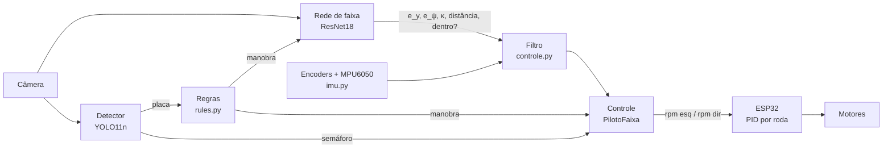
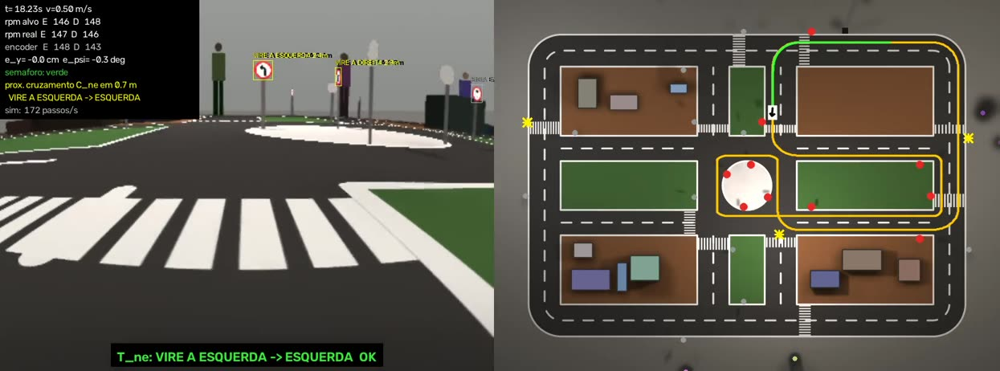

# Visão geral do projeto — C.A.FATEC.R.B · Vista

**Atualizado em 07/11/2026.** Faltam **27 dias** para os treinos na pista oficial (04/12) e **28** para a prova (05/12).

Este é o documento para quem chega agora: o que é o projeto, o que já existe, o que os números dizem, o problema em aberto e o plano até a prova. O histórico detalhado, com cada problema e como foi resolvido, está no [diário de construção](diario-de-construcao.md).

---

## 1. Objetivo

Um carro autônomo em escala 1:10 para a **RoboCar Race 2026**, categoria **MASTER**. Ele larga no semáforo, percorre a minicidade pela rota que as **placas** definem no dia (regulamento 3.5.2), sem sair da pista nem desrespeitar placa. As regras, incluindo o que só aparece nas figuras do PDF, estão em [regulamento.md](regulamento.md).

**Vista** é a IA do carro: lê a câmera, entende a pista (faixa, cruzamento, placas, semáforo), decide e manda a **rotação de cada roda** para o ESP32.

## 2. Estratégia

1. **Simulador primeiro.** A pista é padronizada pelo regulamento, então dá para treinar o Vista antes do carro existir. O **Vista-Sim** é feito só para este carro e esta prova.
2. **Dados reais depois.** Quando o carro estiver pronto, gravar na pista caseira e ajustar as redes à câmera e à luz de verdade.

---

## 3. O carro

| Item | Valor | Origem |
|---|---|---|
| Chassi | 400 × 241 mm, desenho **REV03** | desenho |
| Tração | **diferencial**: 2 rodas Ø65 mm + rodízio; bitola 214 mm. **Não tem direção**: curva pela diferença de rotação | desenho |
| Motores | 530 rpm a 12 V → ~486 rpm a 11 V (~1,65 m/s na roda) | kit |
| Encoder | 440 pulsos/volta | ⚠️ estimado — medir |
| Controle das rodas | **ESP32-S3**: recebe **rpm de cada roda**, PID por roda a 100 Hz | decidido pela equipe |
| Cérebro | **Jetson Orin Nano** | — |
| Câmera | **IMX219 120° 8 MP**, fisheye; captura 1640×1232, processamento 410×308; pitch 15° | REV03; ⚠️ intrínsecos estimados |
| IMU | **MPU6050** (6 eixos, sem magnetômetro) | decidido pela equipe |
| Distância | 4× HC-SR04 | desenho |
| Bateria | LiPo 4S 2200 mAh | — |

Tudo isso está em [`config/car.yaml`](../config/car.yaml) e [`config/camera/`](../config/camera/), a **fonte única de verdade**: o simulador e o Vista real leem os mesmos arquivos.

---

## 4. Arquitetura do Vista (o que vai rodar no carro)



| Peça | O que faz | Arquivo | Estado |
|---|---|---|---|
| Rede de faixa | imagem + manobra → erro lateral `e_y`, erro de rumo `e_ψ`, curvatura à frente, distância ao cruzamento, "já está dentro?" | `treino/faixa.py` | ✅ treinada no Colab; ⚠️ falha nos cruzamentos (seção 7) |
| Detector | 6 placas + semáforo vermelho/amarelo/verde | `treino/deteccao.py` + YOLO11n | ✅ treinado no Colab |
| Regras | placa → manobra (obrigação, proibição, sem placa = em frente) | `vista_sim/rules.py` | ✅ testado |
| Filtro | encoders + giroscópio **preveem** o erro; a rede **corrige** | `vista_sim/controle.py` | ✅ testado |
| Controle | percepção → rpm de cada roda; o **centro do carro** segue a faixa | `vista_sim/controle.py` | ✅ 40/40 rotas com a verdade |
| Odometria | deslocamento pelos encoders, rumo pelo giroscópio, viés calibrado parado no vermelho | `vista_sim/imu.py` | ✅ testado |
| Firmware ESP32 | rpm por roda, PID, telemetria | — | ⬜ a fazer |
| Integração na Jetson | câmera → Vista → serial; motores TensorRT | — | ⬜ a fazer |

**O que não vai para o carro:** o **oráculo** — o piloto automático do simulador, que sabe a posição exata e dirige perfeito. Ele existe só para gerar dados de treino e medir o teto.

---

## 5. Vista-Sim (roda no PC ou no Colab)

| Parte | O que simula |
|---|---|
| **Mapa** | a minicidade **lida nas figuras do regulamento**: 13 × 9 m, vias de 100 e 80 cm, ilha Ø1,4 m, 12 cruzamentos ([ADR 001](adr/001-mapa-pelo-regulamento.md)) |
| **Câmera** | fisheye de 120° com o modelo Kannala-Brandt em NumPy; chão por grade pré-calculada ([ADR 002](adr/002-camera-fisheye-e-chao-por-grade.md)) |
| **Carro** | **roda por roda**: PID do ESP32, zona morta, encoder quantizado, raios diferentes, patinação ([ADR 003](adr/003-carro-em-rotacao-de-roda.md)) |
| **Cenários** | por semente: rota pela cidade, placas que levam à rota (6 classes + distratoras), faixas de pedestre, maquetes, público ([ADR 004](adr/004-cenarios-placas-e-iluminacao.md)) |
| **Luz** | 2–8 lâmpadas, sombras do ambiente e do próprio carro, exposição travada |
| **IMU** | MPU6050 com viés de fábrica de até ±20 °/s, escala ±3 %, ruído e deriva ([ADR 005](adr/005-imu-mpu6050-e-odometria.md)) |
| **Fiscal** | `placa_respeitada`, `desrespeitou_placa`, `saiu_da_pista`, `entrou_na_contramao`, `rota_completa` |



---

## 6. Treino

Pipeline completo no [notebook do Colab](../notebooks/treino_vista.ipynb) ([ADR 006](adr/006-treino-com-dados-do-simulador.md), [ADR 007](adr/007-dagger-e-filtro.md)):

1. **Gerar dados** (`tools/gerar_dataset.py`): o oráculo dirige rotas sorteadas e o simulador grava cada imagem com a resposta exata.
   - montagem da câmera sorteada em cada episódio;
   - ruído de recuperação;
   - vistas deslocadas (o carro até ±15 cm e ±15° fora do lugar);
   - semáforo desenhado em estado sorteado.
2. **Treinar** a rede de faixa (ResNet18 pré-treinada) e o detector (YOLO11n pré-treinado).
3. **Exportar ONNX** (opset 17, lido por TensorRT ≥ 8.6). O motor TensorRT é gerado **na Jetson**.
4. **Avaliar dirigindo no simulador**, em sementes nunca vistas: o número que importa.
5. **DAgger**: a rede dirige, o oráculo socorre quando ela se afasta, e essas situações viram treino.

---

## 7. Onde estamos — resultados

### Simulador e controle

| Medida | Resultado |
|---|---|
| Oráculo em rotas sorteadas | **200/200** completas, 0 placa desrespeitada, erro lateral < 3 cm |
| Rotas sorteadas | 25–66 m, 6–15 cruzamentos, **99 %** entram no centro |
| Carro nas 96 conversões da cidade | com o **centro do carro** seguindo a faixa: **0** saídas |
| Odometria no fim da rota (mediana) | só encoders 1,84 m · + giroscópio **0,51 m** · + escala calibrada **0,19 m** |
| Controle com a verdade | **40/40** rotas completas |
| Velocidade do simulador (320×240) | ~840 passos/s só o chão · ~240 com a cidade inteira |

### Primeiro treino no Colab (A100, 150 episódios)

| Rede | Resultado na validação (episódios nunca vistos) |
|---|---|
| **Detector** | mAP50 **0,948**, mAP50-95 **0,827**. Semáforo nos 3 estados: **0,99**. Placas que mais escapam: `proibido_virar_direita` (recall 0,72) e `seguir_em_frente` (0,75) |
| **Rede de faixa** | erro de `e_y`: ~**0,3 cm** na faixa, ~**1,0 cm** no cruzamento; `e_ψ` ~0,65°; distância ao cruzamento ~3,6 cm |

### A rede dirigindo sozinha (10 rotas nunca vistas)

| | rotas completas |
|---|---|
| teto (mesmo controle com a verdade) | **10/10** |
| rede de faixa | **4/10** — 5 das 6 falhas **dentro do cruzamento** |

Nessa avaliação a manobra e o semáforo ainda vêm da verdade; o detector ainda não está no laço.

### Na Jetson (medido pela equipe)

- **YOLO11n: 10–25 ms por imagem** na mesma Orin Nano do carro, num projeto anterior (soja): imagem 640×640, pipeline inteiro (pré-processamento + inferência + caixas), FP16 ou FP32. É o pior caso para o Vista, que usa 416×416.
- Os modelos do Vista: rede de faixa **11,3 M** parâmetros (5,6 GFLOPs a 240×320); detector **2,6 M** (2,7 GFLOPs a 416×416).
- **Orçamento:** 33 ms por quadro a 30 fps. Caso típico, ~20 ms as duas redes juntas (cabe); pior caso, ~45 ms (não cabe). Padrão seguro: rede de faixa a cada quadro, detector a cada 2–3 quadros. Medir as duas em TensorRT FP16 de 14–20/11.

### O problema atual: o cruzamento

Dentro do cruzamento não há linha pintada: a trilha certa é uma **curva invisível**. Olhando quadro a quadro (com um modelo de teste), a rede acha que ainda está numa reta antes do cruzamento:

| dentro do cruzamento | real | rede |
|---|---|---|
| curvatura | 1,3 /m | ~0 |
| rumo `e_ψ` | −12° → −41° | ~0° |
| "dentro?" | sim | 3 % |

O carro segue reto e entra na rua errada. Testado:

- **Filtro (encoders + giroscópio):** com ruído do dobro do erro da rede, sobe de 8/20 para **14/20** rotas. Ajuda, mas não resolve o cruzamento.
- **DAgger, 1 rodada local** (modelo fraco de teste): **0/8 → 0/8**. Não resolve: a rede não "vê" a curva.

**Proposta (aguardando ok da equipe): atravessar o cruzamento por odometria + giroscópio, usando o mapa.**

1. **Localização no mapa:** o Vista sabe em que rua está seguindo o **grafo do mapa** com as próprias decisões (larga numa rua conhecida; cada manobra leva a outra rua conhecida). Isso também dá as **saídas do cruzamento**, que as placas de proibição precisam.
2. **A curva vem do mapa:** na entrada do cruzamento, a trajetória da conversão sai do mapa, posicionada pelo que a rede vê da faixa (onde ela erra 0,3 cm), e é seguida por encoders + giroscópio (~1,5 m, erro de ~1 cm).
3. **A rede volta a mandar** na saída do cruzamento.

---

## 8. Plano até a prova (proposta)

| Quando | Vista (software) | Carro e equipe |
|---|---|---|
| **07–13/11** | cruzamento por odometria + localização no mapa; detector no laço (placa detectada → `rules.decide`); avaliação no simulador só com o que o carro tem | **enviar as perguntas à organização** (quanto antes, mais tempo para responderem); montar o carro; firmware do ESP32 (rpm por roda + telemetria) |
| **14–20/11** | pipeline na Jetson: câmera → Vista → serial; motores TensorRT; medir a latência real | calibrar a câmera (tabuleiro) e medir o pitch; medir zona morta, PID, encoder e MPU6050 (viés, escala, posição) → atualizar `config/car.yaml`; montar a pista caseira com as medidas do regulamento |
| **21–30/11** | dados reais da pista caseira → ajuste fino das redes; fotos de placas reais no detector | rotas completas no carro real; ajustar velocidades |
| **01–03/12** | congelar o código; checklist de prova; cópias dos modelos; plano B (mais devagar) | revisão do carro, baterias carregadas |
| **04/12** | treino na pista oficial: gravar imagens da pista oficial e ajustar | **único dia na pista real** |
| **05/12** | **prova** | |

---

## 9. Decisões registradas

| ADR | Decisão |
|---|---|
| [001](adr/001-mapa-pelo-regulamento.md) | Mapa pelo regulamento, não pelo `.obj` do organizador |
| [002](adr/002-camera-fisheye-e-chao-por-grade.md) | Câmera fisheye em NumPy e chão por grade |
| [003](adr/003-carro-em-rotacao-de-roda.md) | Carro comandado em rotação de roda; o centro do carro segue a faixa |
| [004](adr/004-cenarios-placas-e-iluminacao.md) | Cenários sorteados: rota, placas pela regra, luz com sombra |
| [005](adr/005-imu-mpu6050-e-odometria.md) | MPU6050 simulada; rumo pelo giroscópio, calibrado no vermelho |
| [006](adr/006-treino-com-dados-do-simulador.md) | Treino: redes pré-treinadas ajustadas com dados do simulador |
| [007](adr/007-dagger-e-filtro.md) | DAgger e filtro com encoders + giroscópio |

Respostas da equipe registradas:
- ESP32 recebe **rpm de cada roda**;
- IMU é a **MPU6050**;
- o repositório está **público**.

## 10. Perguntas em aberto

**Para a organização** (lista completa em [regulamento.md](regulamento.md)):
- penalidade "−10 s" ou "+10 s";
- vias de mão dupla;
- ilha Ø1,4 m;
- como termina a prova da MASTER;
- faixa de pedestre;
- cruzamento sem placa;
- proibição que deixa duas saídas;
- maquetes de prédio.

**Para medir no carro:**
- pitch e intrínsecos da câmera;
- zona morta, constante de tempo e PID do motor;
- pulsos do encoder;
- posição, viés e escala da MPU6050;
- altura do carro montado.

**Para a equipe:** o repositório fica público até a prova?

---

## 11. Como rodar

```bash
pip install -e ".[dev]"                          # simulador + testes
python -m tools.sim_demo --out runs/demo         # vídeo de uma rota pela cidade
pytest                                            # 89 testes

pip install -e ".[treino]"                       # + PyTorch/ONNX
python -m tools.gerar_dataset --out dataset --episodios 150
python -m tools.avaliar_modelo --onnx faixa.onnx --sementes 100000:100010
```

No Colab: abrir [`notebooks/treino_vista.ipynb`](../notebooks/treino_vista.ipynb), GPU, `Executar tudo`.

## 12. Mapa do repositório

| Caminho | O quê |
|---|---|
| `config/` | carro, motor, encoder, PID, MPU6050, câmera — fonte única de verdade |
| `maps/robocar_master.yaml` | mapa oficial, gerado por `vista_sim/maps/build_master.py` |
| `vista_sim/` | simulador **e** a lógica que vai para o carro (`rules.py`, `controle.py`, `imu.py`) |
| `treino/` | rede de faixa, dataset do detector, avaliação dirigindo |
| `tools/` | demo com vídeo, gerador de dados, avaliação de modelo ONNX |
| `notebooks/` | notebook do Colab |
| `tests/` | 89 testes automáticos |
| `docs/` | regulamento lido, análise de FOV, ADRs, diário, resumos |
